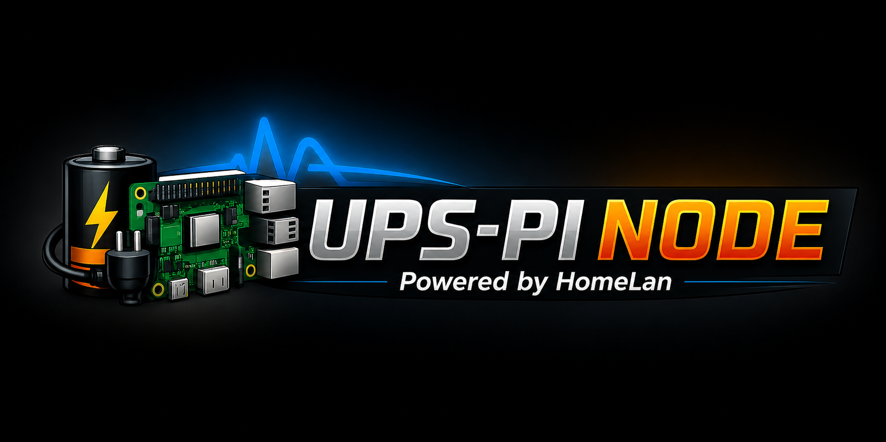
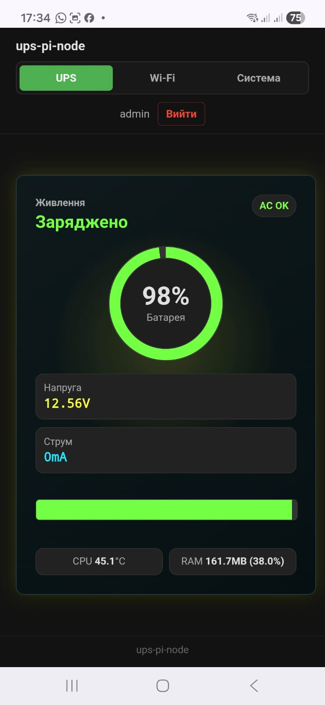
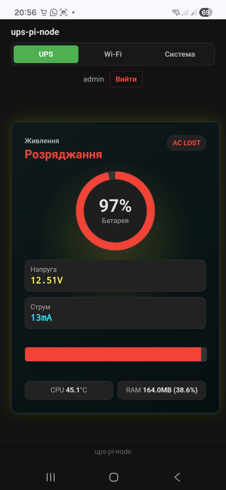
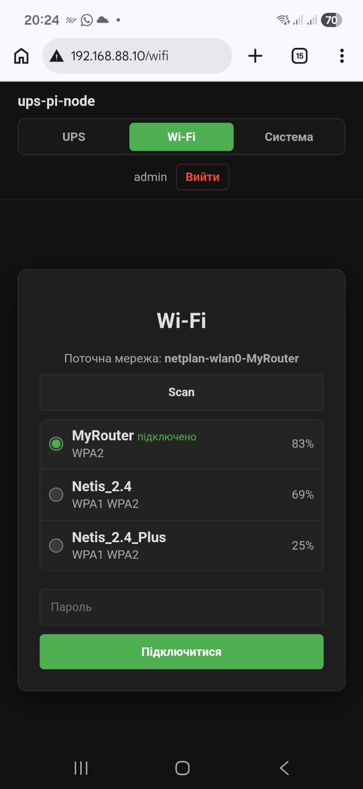
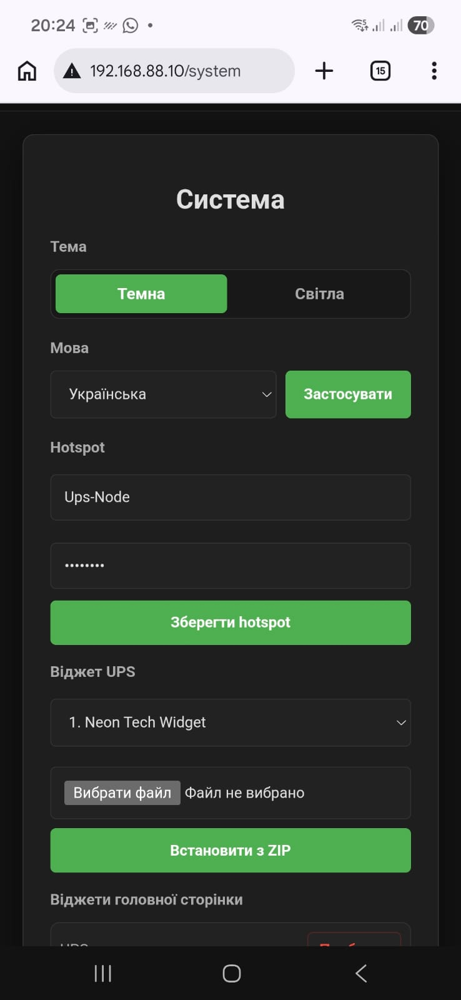

# ups-pi-node




`ups-pi-node` is a small web-managed UPS node for Raspberry Pi hardware. It monitors UPS state, exposes a local browser UI, manages Wi-Fi setup, and can raise a fallback hotspot when the device is not connected to a known network.

The project is especially useful for DIY power projects, home labs, and custom
embedded UPS builds where the hardware may be assembled from common modules
such as INA3221 monitors, external current shunts, relay boards, Li-ion battery
packs, and small SPI TFT screens.

The project is designed for a Raspberry Pi based power node: the web app stays lightweight, and privileged system operations are delegated to a helper service instead of being executed directly by the site.

## Web UI Preview

Real screenshots from the verified Raspberry Pi Zero 2 W node:

| Login | UPS charging | UPS discharging | Wi-Fi setup | System settings |
| --- | --- | --- | --- | --- |
|  |  |  |  |  |

## Features

- UPS dashboard with battery and 19 V output voltage/current, battery level,
  AC status, CPU and RAM telemetry.
- Wi-Fi setup page with available network scan, password entry, and connection action.
- Fallback hotspot support through NetworkManager and systemd.
- System helper socket for privileged system tasks.
- Theme selector for dark and light UI.
- Interface language selector with Ukrainian and English only.
- UPS widget selector with built-in widget styles.
- Removable dashboard widgets for the main UPS card, CPU, RAM, and Wi-Fi status.
- Custom widget installation from ZIP packages with CSS, images, and fonts.
- Zabbix and Home Assistant integration metrics without Wi-Fi/portal-mode telemetry.
- Configuration through `/etc/ups-pi-node/main.conf`.

## Hardware Profile

The relay, display, web, sensor, and packaging stack was tested on a real
Raspberry Pi UPS node. The current sensor profile has moved from INA219 to
INA3221 with two external FL-2C 20 A / 75 mV shunts. Battery channel 1 and
19 V output channel 2 were both validated on live hardware.

Tested node:

```text
Board: Raspberry Pi Zero 2 W
OS: Debian 13 / Raspberry Pi OS Trixie, 32-bit armv7l
Software profile: ups-pi-node 0.2.2-6
UPS sensor: INA3221 on I2C bus 1, address 0x40
Battery: channel 1 with FL-2C 20 A / 75 mV, 0.00375 ohm
19 V output: channel 2 with identical FL-2C shunt
Display: ST7735 SPI TFT, 128x160 portrait, V1.1 board
Control: 2 relay outputs plus AC detect input
```

Confirmed working on the test node:

- Web UI and system helper services.
- Live voltage, bidirectional battery current, and 19 V output telemetry from
  INA3221 channels 1 and 2.
- Main charge logic, including relay switching for `CHARGE`.
- ST7735 stacked BATTERY/19V OUTPUT portrait dashboard rendered with Ubuntu
  fonts and controlled LED/BLK backlight.
- Wi-Fi fallback hotspot with default SSID `Ups-Node`.
- Debian package install and upgrade flow on Trixie.

The detailed wiring, power-path findings, live measurements, and service checks
from 2026-07-18 are recorded in
[docs/hardware-validation-2026-07-18.md](docs/hardware-validation-2026-07-18.md).

Observed resource use on Raspberry Pi Zero 2 W after boot:

```text
Load average: about 0.18
CPU idle: about 95%
RAM used: about 156 MiB of 425 MiB
Swap used: 0 MiB
Helper RSS: about 26 MiB
Web service RSS: about 27 MiB
```

### Display Wiring

The display wiring below is the verified wiring from the working test node.
The application config uses BCM GPIO numbers, while the table also lists the
physical Raspberry Pi header pins for soldering/debugging.

| TFT pin | Raspberry Pi physical pin | BCM GPIO | Notes |
| --- | ---: | ---: | --- |
| LED / BLK | 12 | 18 | Backlight, driven HIGH by helper |
| SCK | 23 | 11 | SPI0 SCLK |
| SDA / MOSI | 19 | 10 | SPI0 MOSI |
| A0 / DC | 18 | 24 | Data/command |
| RESET | 22 | 25 | Display reset |
| CS | 24 | 8 | SPI0 CE0 |
| GND | 20 | - | Ground |
| VCC | 17 | - | 3.3 V |

Relevant config defaults:

```ini
[display]
enabled = true
spi_port = 0
spi_device = 0
dc_pin = 24
rst_pin = 25
width = 160
height = 128
rotate = 1
backlight_pin = 18
bus_speed_hz = 0
```

The backlight is intentionally enabled after ST7735 initialization and again
before each render. This matches the verified hardware behavior on the test
node. With `rotate = 1`, the effective display bounds are `128x160` portrait.
The renderer detects the bounds and selects the stacked portrait layout
automatically; landscape bounds retain the two-column layout.

### Raspberry Pi Power Input

The verified node uses a separate supply path for the Raspberry Pi:

```text
DC power supply -> DC buck converter -> dedicated UPS -> Raspberry Pi
```

Power is soldered to the marked pads on the underside of the USB power
connector. Verify polarity at the pads before connecting the Pi.

INA3221 `VS` is powered from physical pin 1 (`3.3 V`). The Raspberry Pi ground
pins are 6, 9, 14, 20, 25, 30, 34, and 39. A polarized connector such as XT30
reduces the risk of reconnecting the power input backwards; the assembled
connector polarity must still be checked with a multimeter.

### UPS GPIO Wiring

The current hardware profile follows the original working controller.

| Function | BCM GPIO | Notes |
| --- | ---: | --- |
| AC detect input | 17 | Input with pull-up; active low means AC OK |
| Relay 1 | 27 | Load source selection |
| Relay 2 pair | 22 | Two physical relays on one GPIO for synchronized battery charge/load switching |

### INA3221 And FL-2C Wiring

The INA3221 uses I2C bus 1 at address `0x40`. The battery uses channel 1 and
the 19 V output uses channel 2. Both channels use an FL-2C `20 A / 75 mV`
shunt, so the nominal resistance of each shunt is:

```text
R = 0.075 V / 20 A = 0.00375 ohm
```

Recommended battery-side polarity:

```text
charger / relay side -- FL-2C -- battery positive
       INA3221 IN+     sense     INA3221 IN-
```

Recommended 19 V output polarity on channel 2:

```text
19 V source side -- FL-2C -- 19 V load side
 INA3221 CH2 IN+  sense  INA3221 CH2 IN-
```

With this orientation, charging current is positive, discharging current is
negative, and the INA3221 bus-voltage input at `IN-` measures the battery side.
Use short Kelvin sense wires from the FL-2C sense points to `CH1 IN+` and
`CH1 IN-`. The 20 A path must pass through the FL-2C current terminals, not
through INA3221 module traces. If the module has an onboard shunt on channel 1,
it must be removed or bypassed according to that module's schematic before an
external FL-2C is connected.

Raspberry Pi I2C wiring:

| INA3221 | Raspberry Pi physical pin | BCM GPIO |
| --- | ---: | ---: |
| VS / VCC | 1 | 3.3 V |
| GND | 6 | GND |
| SDA | 3 | 2 |
| SCL | 5 | 3 |

Relevant configuration:

```ini
[ups]
backend = ina3221
i2c_bus = 1
i2c_address = 0x40
ina3221_channel = 1
ina3221_output_channel = 2
ina3221_averaging = 16
shunt_ohms = 0.00375
current_polarity = 1
output_shunt_ohms = 0.00375
output_current_polarity = 1
```

Set `current_polarity = -1` only when the sense polarity is intentionally
reversed. INA3221 inputs must remain within the device's 26 V common-mode
limit. Register layout, conversion factors, and electrical limits come from the
[Texas Instruments INA3221 datasheet](https://www.ti.com/lit/ds/symlink/ina3221.pdf).

Do not assume that INA219 and INA3221 breakout boards are contact-for-contact
compatible. Check `VS/VCC`, `GND`, `SDA`, and `SCL` against the exact module
silkscreen or schematic before replacement. The INA219 supports a `3.0-5.5 V`
supply and the INA3221 supports `2.7-5.5 V`, so both ICs can be powered from
5 V. The verified node instead powers INA3221 from 3.3 V on physical pin 1 to
match Raspberry Pi logic; also check the breakout board's I2C pull-ups.

On the verified hardware, the battery route is switched by two relay modules
connected to the same GPIO22 control line. They move together so the battery is
switched synchronously between the charger path and the load path.

## Installation

The install target is Raspberry Pi Zero 2 W running Debian 13 / Raspberry Pi OS
Trixie, 32-bit `armv7l`.

Copy the Debian package to the node:

```bash
scp dist/ups-pi-node_0.2.2-6_all.deb admin@zero2.local:~/
```

Install with `apt` so dependencies are resolved automatically:

```bash
ssh admin@zero2.local
sudo apt update
sudo apt install ./ups-pi-node_0.2.2-6_all.deb
```

If you use `dpkg` directly, finish dependency setup with `apt`:

```bash
sudo dpkg -i ./ups-pi-node_0.2.2-6_all.deb
sudo apt -f install
```

Check services after installation:

```bash
dpkg -s ups-pi-node | grep -E '^(Status|Version|Architecture)'
sudo systemctl status --no-pager ups-pi-node-helper ups-pi-node
```

The package enables the needed I2C/SPI boot config entries. Reboot once if this
is the first install or if `/dev/i2c-1` / `/dev/spidev0.0` did not exist before:

```bash
sudo reboot
```

Open the web UI at `http://zero2.local/` while the node is connected to Wi-Fi.
During the 2026-07-18 validation its DHCP address changed from
`192.0.2.10` to `192.0.2.40` after reconnecting. These addresses are
observations, not permanent configuration; prefer `zero2.local` or reserve a
lease in the router. In fallback hotspot mode the default network is `Ups-Node`,
password `12345678`, and the portal is available at:

```text
http://10.42.0.1/
```

## Runtime Layout

Default install paths:

```text
/usr/lib/ups-pi-node
/etc/ups-pi-node/main.conf
/etc/default/ups-pi-node
/var/lib/ups-pi-node
/run/ups-pi-node/helper.sock
```

Application code is installed read-only under `/usr/lib/ups-pi-node`; runtime state such as the virtualenv, uploaded widget packages, and dashboard widget layout lives under `/var/lib/ups-pi-node`. Debian packages create `/var/lib/ups-pi-node/.venv` and expose Debian Python dependencies inside that venv.

Main services:

```text
ups-pi-node.service
ups-pi-node-helper.service
ups-pi-node-hotspot-fallback.service
ups-pi-node-hotspot-fallback.timer
```

## Environment

Preferred environment variables use the `UPS_PI_NODE_` prefix:

```text
UPS_PI_NODE_SECRET_KEY
UPS_PI_NODE_NODE_ID
UPS_PI_NODE_INTEGRATIONS_TOKEN
UPS_PI_NODE_CONFIG_FILE
UPS_PI_NODE_WIDGETS_DIR
UPS_PI_NODE_DASHBOARD_WIDGETS_FILE
UPS_PI_NODE_AUTH_MODE
UPS_PI_NODE_PORTAL_USERNAME
UPS_PI_NODE_PORTAL_PASSWORD
UPS_PI_NODE_SYSTEM_HELPER_SOCKET
UPS_PI_NODE_WIFI_BACKEND
UPS_PI_NODE_WIFI_INTERFACE
UPS_PI_NODE_HOTSPOT_CONNECTION_NAME
UPS_PI_NODE_HOTSPOT_SSID
UPS_PI_NODE_HOTSPOT_PASSWORD
UPS_PI_NODE_HOTSPOT_ADDRESS
UPS_PI_NODE_PORTAL_MODE
UPS_PI_NODE_UPS_BACKEND
UPS_PI_NODE_AC_SENSOR_PIN
UPS_PI_NODE_MOCK_BUS_VOLTAGE
UPS_PI_NODE_MOCK_CURRENT_MA
UPS_PI_NODE_MOCK_OUTPUT_VOLTAGE
UPS_PI_NODE_MOCK_OUTPUT_CURRENT_MA
UPS_PI_NODE_BATTERY_EMPTY_VOLTAGE
UPS_PI_NODE_BATTERY_FULL_VOLTAGE
```

## Local Preview

For a local mock preview:

```bash
UPS_PI_NODE_SECRET_KEY=preview-secret \
UPS_PI_NODE_AUTH_MODE=mock \
UPS_PI_NODE_WIFI_BACKEND=mock \
UPS_PI_NODE_UPS_BACKEND=mock \
python wsgi.py
```

In the Codex preview environment this app has been run through WSL on:

```text
http://127.0.0.1:5000/login
```

Mock auth accepts any non-empty username and password.

## Debian Package Builds

The release base version lives in `debian/changelog`. Local package builds add
an automatic Debian revision by default, for example:

```text
0.2.2-1
0.2.2-2
```

This makes every rebuilt `.deb` newer for `apt`, while still showing which base
release it came from. The next revision is calculated from existing packages in
`dist/`.

Build from WSL with:

```bash
scripts/build-deb-wsl.sh "$PWD" "$PWD/dist"
```

Set `UPS_PI_NODE_AUTO_VERSION=0` to build the exact changelog version, set
`UPS_PI_NODE_BUILD_REVISION=7` to force the next `0.2.2-7` style revision, or
set `UPS_PI_NODE_BUILD_VERSION=0.2.2-7` to force a full package version.

During package installation the app uses Debian dependencies inside the venv by
default, which keeps Raspberry Pi installs faster and avoids pip resolver noise.
Set `UPS_PI_NODE_INSTALL_PIP_REQUIREMENTS=1` only when you intentionally want to
run `pip install --no-index -r requirements.txt` during `postinst`.

## Raspberry Pi Hardware Buses

On Raspberry Pi hardware the Debian package runs `ups-pi-node-enable-buses`
during setup. It enables the boot config entries needed by the INA3221 and
ST7735 display:

```text
dtparam=i2c_arm=on
dtparam=spi=on
```

It also writes `/etc/modules-load.d/ups-pi-node.conf` for `i2c-dev`,
`i2c-bcm2835`, and `spi-bcm2835`, then tries to load those modules immediately.
If the boot config changed, reboot once before expecting `/dev/i2c-1` and
`/dev/spidev0.0` to appear reliably.

The ST7735 display uses the wiring from the original controller: SPI0/CE0,
DC GPIO24, RST GPIO25, LED/BLK GPIO18, controller dimensions 160x128, and
`rotate = 1`. The effective bounds on the verified panel are 128x160 portrait.
The config values use BCM GPIO numbering, not physical header pin numbers.

## Widget Packages

Custom widgets are installed from ZIP packages. A minimal package:

```text
my-widget.zip
└── my-widget/
    ├── widget.json
    ├── style.css
    └── assets/
        └── display.woff2
```

See [docs/widgets.md](docs/widgets.md) for the widget package format, CSS variables, live fields, assets, fonts, and animation support.

## Integrations

Zabbix and Home Assistant receive only useful UPS/system metrics: battery, voltage, current, power, AC state, CPU, RAM, and app health. Wi-Fi SSID, hotspot state, and portal mode stay local to the UI.

See [docs/integrations.md](docs/integrations.md) for metric keys, Zabbix agent parameters, and Home Assistant discovery payloads.

## Stack

- Python / Flask
- Gunicorn + Nginx
- NetworkManager / nmcli
- systemd services and timers
- INA3221 UPS backend with battery channel 1 and 19 V output channel 2,
  using configurable external shunt resistances

## Status

The project is in active development. Current work is focused on the portal UI, helper isolation, deploy packaging, and custom widget support.

The phased Go migration, compatibility boundary, Wi-Fi state machine, and
acceptance criteria are documented in
[docs/go-migration.md](docs/go-migration.md).
